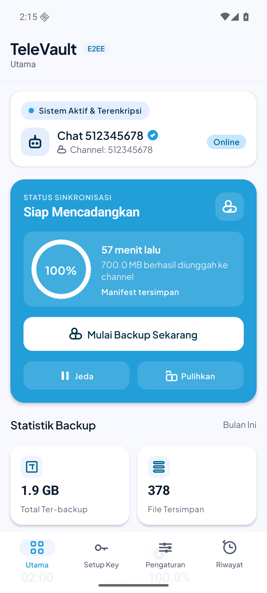
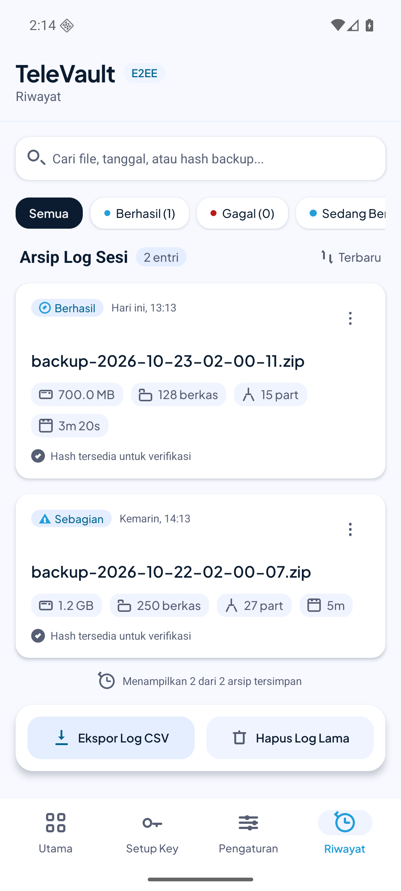
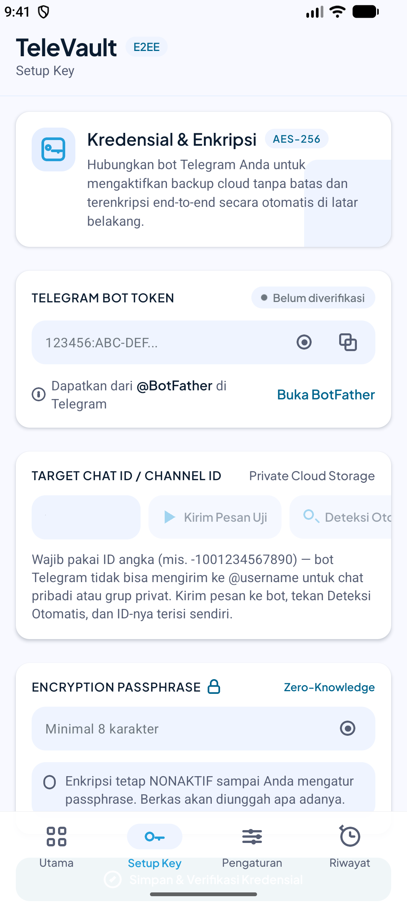
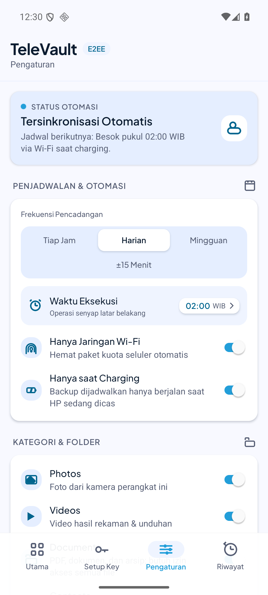

<div align="center">


# TeleVault

**Backup terenkripsi dari HP Android langsung ke Telegram**, tanpa server, tanpa langganan cloud.

File besar dipotong, dienkripsi di perangkat, lalu dikirim sebagai dokumen ke chat bot pribadi kamu.
Dari chat itu semuanya bisa dipulihkan lagi lewat aplikasi.

[](https://github.com/ryznoxy/televault/actions/workflows/ci.yml)
[](https://github.com/ryznoxy/televault/actions/workflows/release.yml)


</div>

---

## Tampilan

| Utama | Riwayat |
|:---:|:---:|
|  |  |
| **Setup** | **Pengaturan** |
|  |  |

## Fitur

- **Enkripsi di perangkat**: AES-256-GCM, kunci dari PBKDF2-SHA256 (210.000 iterasi, salt 16 byte, IV 12 byte **per potongan**). Passphrase tidak pernah dikirim ke Telegram; hanya salt dan IV-nya.
- **Kategori backup**: Photos, Videos, Documents, dan folder custom bebas lewat SAF (juga di Android). Contacts dan SMS menyusul (lihat [Batasan](#batasan-yang-diketahui)).
- **Chunking**: file dipecah maksimal 49 MB per bagian supaya lolos batas 50 MB Bot API; dengan enkripsi aktif batasnya 16 MB supaya puncak RAM tetap rendah. Arsip dinamai `backup-<waktu>.zip` (contoh `backup-2026-10-20-09-31-00.zip`), potongannya `…zip.001`, `.002`, dan seterusnya. Setiap potongan dienkripsi sendiri, jadi backup multi-GB tidak perlu menahan seluruh arsip di memori.
- **Backup inkremental**: file yang `mtime`-nya tidak berubah dilewati, jadi backup harian hanya mengunggah yang baru. Maksimal berkas per run bisa diatur (default 250); sisanya lanjut otomatis di run berikutnya.
- **Kirim media langsung**: foto dan video di bawah batas ukuran (default 45 MB, maksimal 45 MB) dikirim apa adanya ke Telegram, jadi langsung bisa dibuka; yang lebih besar tetap di-zip. Fitur ini butuh enkripsi mati, karena berkas terenkripsi (`.enc`) tidak bisa dibuka di Telegram dan potongan terenkripsinya dibatasi 16 MB. Nonaktifkan tombolnya kalau mau semua di-zip.
- **Manifest dan skrip reassembly**: setiap arsip mengirim `<nama>.manifest.json` (ukuran, jumlah chunk, SHA-256, daftar IV, info enkripsi) plus skrip `.sh`/`.bat` untuk menyatukan potongan tanpa aplikasi.
- **Restore one-tap dari bot**: pilih sesi di layar Pulihkan, manifest dan semua potongan diunduh otomatis dari chat bot, lalu gabung, verifikasi SHA-256, dekripsi per potongan, ekstrak zip. Tersedia untuk backup yang dibuat sejak v1.1.0 (app menyimpan `file_id` Telegram tiap potongan; DB lokal yang menyimpannya hilang kalau app dihapus). Backup lama tetap bisa dipulihkan manual: download potongan dan manifest dari Telegram, lalu "Pilih berkas backup". Iterasi PBKDF2 restore mengikuti yang tercatat di manifest (minimum 210.000), jadi backup lama tetap bisa dibuka.
- **Uji Pemulihan (drill)**: satu tombol di Troubleshooting yang mengunduh arsip terkecil dari Telegram, mendekripsi, lalu mencocokkan hash-nya di folder sementara. Membuktikan backup benar-benar bisa dipulihkan, bukan sekadar berharap.
- **Self-update**: app membaca versi terpasang langsung dari `PackageManager`, lalu membandingkan dengan rilis terbaru di [Releases](https://github.com/ryznoxy/televault/releases) (maksimal 1 cek sukses per jam, plus cek saat app dibuka kembali). Kalau ada versi baru, alert muncul melayang di atas layar mana pun - bukan cuma di tab - dengan tombol **Perbarui** dan **Nanti**, progres unduh, dan tombol batal. Rilis yang ditemukan disimpan, jadi restart app dalam jam tenang tetap menampilkannya. APK diverifikasi SHA-256 sebelum installer terbuka, dan dibuang kalau tidak cocok. Tombol **Cek Pembaruan** di Pengaturan melewati throttle dan memunculkan alert lagi walau sudah pernah ditutup.
- **Modal "Apa baru"**: sekali sehabis update, ringkasan perubahan versi tampil di app (per versi, dari `src/update/whatsNew.ts`).
- **Notifikasi status permanen**: satu notifikasi ongoing low-priority menampilkan kapan backup terakhir berjalan, bukti app tetap hidup di latar belakang. Saat backup berjalan, notifikasi foreground service memuat progres persen dan kecepatan upload. Disembunyikan otomatis saat otomasi dijeda atau mode manual.
- **Tour persiapan latar belakang**: sehabis setup pertama, tour 3 langkah memandu izin tanpa optimasi baterai (dialog sistem langsung) dan autostart per merek HP. Bisa diulang dari Troubleshooting.
- **Setup tanpa browser**: Chat ID dideteksi otomatis: kirim pesan ke bot, tekan Deteksi Otomatis, kolom terisi sendiri (wajib ID angka; bot tidak bisa mengirim ke @username untuk chat pribadi atau grup privat).
- **Penjadwalan**: manual, interval (jam), jam tertentu tiap hari, atau hanya saat charging. Jadwal jam tertentu memakai alarm eksak bentuk alarm jam (`setAlarmClock`), bukan job periodik yang bisa digeser Doze, dan alarm itu yang menjalankan backup di latar belakang. Alarm dipasang ulang setelah HP reboot atau jam/zona waktu berubah, tanpa perlu app dibuka. Selama jadwal aktif, ikon alarm tampil di status bar (tap ikon itu membuka app); itu konsekuensi memakai alarm bentuk alarm jam, tidak ada suara atau dering yang dibunyikan app.
- **Jalan di background**: `react-native-background-fetch` plus foreground service, termasuk headless task saat aplikasi tertutup. Backup jam tertentu berjalan di foreground service milik alarm eksaknya sendiri, karena Android 12 ke atas menolak service yang dimulai dari job latar belakang.
- **Upload tahan putus**: retry dengan backoff (`Retry-After` 429 dihormati, dibatasi 60 detik); progres, kecepatan upload, dan estimasi sisa waktu tampil di layar Utama; riwayat sesi dan statistik tersimpan lokal (SQLite) dan bisa diekspor CSV.
- **Hentikan di tengah jalan**: tombol Hentikan di kartu progres layar Utama dan di notifikasi backup berjalan. Permintaan dicek antar potongan dan antar berkas, jadi tidak ada potongan setengah terkirim; berkas yang sudah naik tetap tercatat, sisanya lanjut di backup berikutnya, dan sesi ditutup sebagai `partial`.
- **Progres lintas proses**: layar Utama membaca sesi yang sedang berjalan dari DB (kolom `chunks_sent`/`chunks_total`), bukan hanya state layar, jadi backup otomatis yang dijalankan alarm tetap terlihat progresnya meski app dibuka belakangan.
- **Jeda kirim adaptif**: gap antar kiriman mulai dari 1 detik dan naik ke jendela `retry_after` saat Bot API menolak (429), lalu turun perlahan lagi kalau kiriman lancar. Percobaan 429 lebih banyak daripada error biasa supaya potongan tidak dilewati dan arsip tidak jadi tidak lengkap.
- **Troubleshoot**: layar diagnostik untuk izin, koneksi bot, panduan baterai per OEM, kapan sistem terakhir membangunkan app, plus log error ringan (ring buffer 20 entri) supaya kegagalan yang tertelan tetap kelihatan. Ketuk "Kegagalan terakhir" untuk melihat alasan lengkapnya di popup.
- **Wifi-only** dan passphrase strength check.
- **Tema terang dan gelap**: toggle dark mode di Settings, semua layar ter-tokenisasi mengikuti.

## Alur backup

```
scan kategori → saring file berubah → (opsional) zip → potong 49 MB → enkripsi per potongan
   → upload sendDocument ke chat bot (simpan file_id tiap potongan & manifest) → catat sesi di SQLite
```

## Instalasi

APK siap install ada di halaman [**Releases**](https://github.com/ryznoxy/televault/releases). Ambil `app-release.apk` dari rilis terbaru, buka, dan install (Android akan minta konfirmasi "Install anyway" dari Play Protect, normal untuk APK di luar Play Store).

Update berikutnya tidak perlu download manual lagi: buka app, kalau ada versi baru alert akan muncul di atas layar dengan tombol Perbarui.

## Prasyarat (untuk build dari source)

- Node.js >= 22.11, JDK 17, Android SDK (mengikuti [set up environment](https://reactnative.dev/docs/set-up-your-environment)).
- Bot Telegram: buat lewat [@BotFather](https://t.me/BotFather). Chat ID tidak perlu dicari manual, kirim pesan ke bot lalu di layar Setup tekan **Deteksi Otomatis**.

> [!IMPORTANT]
> Token bot, chat ID, dan passphrase enkripsi disimpan di keychain atau keystore perangkat lewat `react-native-keychain`, bukan di source atau `.env`. Ketiganya hanya dibaca saat backup atau restore berjalan dan tidak pernah dikirim ke Telegram. Menghapus aplikasi menghapus keychain-nya, jadi simpan passphrase di tempat lain juga.

## Menjalankan

```sh
npm install
npm start          # Metro
npm run android    # terminal lain
```

Di aplikasi: layar Setup, tempel token bot, kirim pesan ke bot, Deteksi Otomatis chat ID, kirim pesan tes, pilih kategori dan jadwal serta passphrase, lalu backup pertama. Selesai setup, tour persiapan latar belakang muncul otomatis.

## Pengembangan

```sh
npm test           # Jest
npm run typecheck  # tsc --noEmit
npm run lint       # ESLint
```

Ketiganya juga jalan di CI (`.github/workflows/ci.yml`) untuk setiap push ke `main` dan setiap pull request.

Struktur:

```
src/
  backup/      scan, chunker, crypto, hasher, manifest, zip, upload retry, runner backup, restore, drill
  background/  scheduler, foreground service, headless task, status notifikasi, panduan OEM, aturan kapan backup jalan
  components/  komponen UI, alert update, modal "Apa baru", tour latar belakang
  db/          op-sqlite: schema dan repository sessions/files/chunks
  net/         klien Bot API (token selalu di-redact dari error)
  navigation/  root navigator
  screens/     Home, Setup, Restore, Settings, Stats, Troubleshoot
  state/       zustand store (MMKV persist), secure store, riwayat, log error, update, tour
  theme/       token warna terang dan gelap
  update/      self-updater (cek rilis, unduh APK, verifikasi checksum), catatan versi
__tests__/     unit test per modul
```

## Rilis

Rilis otomatis lewat GitHub Actions: **push tag `vX.Y.Z` → workflow [`release.yml`](.github/workflows/release.yml) build APK signed plus `SHA256SUMS`, lalu tempel keduanya ke GitHub Release**. App yang sudah ter-install mendeteksinya lewat alert self-update.

Persiapan sekali saja (mesin rilis atau repo):

1. Buat upload keystore sekali (simpan file dan password-nya; kehilangan keduanya berarti tidak bisa merilis update lagi):

   ```sh
   keytool -genkeypair -v -keystore televault-upload.keystore \
     -alias televault -keyalg RSA -keysize 2048 -validity 10000
   ```

2. Set 4 repo secrets (**Settings → Secrets and variables → Actions**):

   | Secret | Isi |
   |---|---|
   | `TELEVAULT_STORE_FILE_B64` | keystore di-encode base64 (`base64 -w0 televault-upload.keystore`) |
   | `TELEVAULT_STORE_PASSWORD` | password keystore |
   | `TELEVAULT_KEY_ALIAS` | alias key (mis. `televault`) |
   | `TELEVAULT_KEY_PASSWORD` | password key |

3. Untuk build release lokal (di luar CI), taruh propertinya di `~/.gradle/gradle.properties`, **jangan** di `android/gradle.properties` yang ikut ter-commit:

   ```properties
   TELEVAULT_STORE_FILE=/absolute/path/televault-upload.keystore
   TELEVAULT_STORE_PASSWORD=...
   TELEVAULT_KEY_ALIAS=televault
   TELEVAULT_KEY_PASSWORD=...
   ```

   Kalau salah satu properti kosong, build release **gagal** dan tidak diam-diam memakai debug key.

Rilis versi baru:

```sh
git tag v1.3.2 && git push origin v1.3.2
```

`versionName` dan `versionCode` di-stamp otomatis dari tag (versionCode = semver encoded: `v1.2.3` → `10203`), tidak perlu edit `build.gradle` per rilis.

## Batasan yang diketahui

- **7z belum didukung**: writer 7z tidak tersedia di Hermes; opsi format ditampilkan tapi dinonaktifkan (`src/backup/zipper.ts`).
- **49 MB per chunk**: batas Bot API publik (16 MB saat enkripsi aktif, demi RAM). Server Bot API lokal bisa menaikkan ini, tapi belum jadi target build.
- **Contacts dan SMS belum ada**: barisnya tampil nonaktif ("Segera hadir"); belum ada reader-nya.
- **Documents tidak terbaca di Android 11+**: sistem menutup folder `Download` dan `Documents` publik dari aplikasi biasa, jadi kategori ini membaca 0 berkas di perangkat modern; ringkasan backup memberitahukannya.
- **Android 15+ membatasi foreground service `dataSync` kurang lebih 6 jam per hari**: backup yang lebih lama dari itu bisa dihentikan sistem; jalankan ulang atau kecilkan jumlah berkas per run (`maxFilesPerRun`).
- **Jadwal global, bukan per folder**: satu jadwal untuk semua kategori terpilih.
- **Jam tertentu butuh izin alarm eksak**: Android 12 ke atas membatasi alarm eksak, jadi app memakai izin alarm (di Android 13+, `USE_EXACT_ALARM` diberikan tanpa dialog). Kalau izin itu dicabut, penjadwalan turun ke alarm tidak eksak dan bisa bergeser beberapa menit.
- **Job periodik tetap tidak eksak**: mode interval dan charging masih lewat JobScheduler `react-native-background-fetch`; Doze dan pembatasan merek (mis. MIUI autostart) bisa menundanya.
- **Alarm eksak masih bisa ditahan sebagian merek**: alarm bentuk alarm jam lolos Doze di Android stok dan umumnya dihormati MIUI, tapi pembatasan merek tetap bisa menahannya. Baris Troubleshooting "Jadwal terakhir bangun" kini menuliskan sumbernya: "alarm eksak" kalau alarmnya sendiri yang membangunkan, "JobScheduler" kalau yang jalan justru job periodik yang tidak eksak; itu tanda alarmnya tertahan. Autostart dan bebas optimasi baterai mengurangi, bukan menghilangkan.
- **Restore one-tap butuh DB lokal**: `file_id` potongan disimpan di SQLite app. Hapus app berarti hilang; restore HP baru tetap bisa lewat jalur manual (download dari Telegram).
- **Autostart tidak bisa diaktifkan secara programatik**: tidak ada API Android untuk itu; app hanya bisa membuka layar setelan merek yang tepat, sisanya keputusan pengguna.
- **APK debug butuh Metro; pakai build release**: hanya `assembleRelease` yang membundel JS. APK di Releases sudah release build.
- **Package Kotlin masih `com.telebotbackuprn`**, tapi id yang dipasang dan dipublikasikan adalah `com.televault.app`; id ini permanen setelah rilis pertama.

Checklist rilis lengkap ada di [`docs/release-checklist.md`](docs/release-checklist.md).

## Git

`main` stabil. Setiap fitur atau perbaikan di branch sendiri:

```sh
git switch main && git pull --ff-only
git switch -c feat/<slug>
# ... commit kecil, Conventional Commits: feat(backup): ...
git push -u origin feat/<slug>
git switch main && git merge --no-ff feat/<slug>
```

Branch tidak dihapus sampai fitur terverifikasi di device, supaya bug susulan bisa di-fix di branch yang sama.

---

<div align="center">
<sub>TeleVault: backup kamu, kunci kamu, channel kamu.</sub><br/>
<sub>Vibe coded dengan Claude.</sub>
</div>
